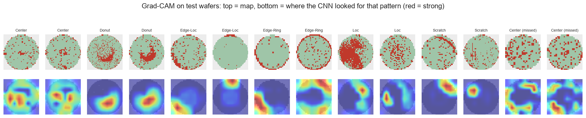

# Manufacturing AI Portfolio

반도체 제조 데이터로 불량을 예측하고 해석하는 프로젝트 모음입니다.
모델 점수보다 **실제 생산 라인에서 믿을 수 있는 평가**를 설계하는 데 집중했습니다.

## 핵심 메시지

두 종류의 제조 데이터(공정 센서 숫자, 웨이퍼 이미지)에서 같은 결론을 얻었습니다.
**평가를 현실에 맞게 설계하지 않으면 성능이 크게 부풀려집니다.**

| 프로젝트 | 현실과 다른 평가 | 현실에 맞춘 평가 | 원인 |
|---|---|---|---|
| SECOM | 무작위 분할 PR-AUC 0.17 | 시간순 분할 0.07~0.09 | 같은 시기 제품이 학습과 평가에 섞임 |
| Wafer Map | 로트 단위 교차검증 매크로 F1 0.94 | 평가 데이터 0.71 | 같은 제품이 학습과 검증에 섞임 |

## 프로젝트

| 프로젝트 | 데이터 | 문제 | 모델 |
|---|---|---|---|
| [SECOM](secom/) | UCI SECOM, 공정 센서 590개 × 1,567개 생산 단위 | 센서 값으로 불량 예측, 점검할 센서 찾기 | 로지스틱 회귀, LightGBM, SHAP |
| [Wafer Map](wafer-map/) | WM-811K, 라벨 있는 웨이퍼 맵 172,950개 | 웨이퍼 불량 패턴 9가지 분류 | 모양 특징 + LightGBM, CNN, Grad-CAM |

## SECOM 요약

**문제**: 공정 센서 590개로 생산 단위의 불량(6.6%)을 미리 예측하고, 엔지니어가 먼저 점검할 센서를 찾습니다.

**결과**
- 위험도 상위 20%를 검사하면 로지스틱 회귀가 불량 24개 중 6개를 잡았습니다(무작위 기대값 4.8개). 다만 신뢰구간으로 보면 무작위와 통계적으로 구분되지 않습니다.
- 같은 모델을 무작위 분할로 평가하면 PR-AUC가 약 2~2.4배 높게 나옵니다.
- 학습 기간에 정한 확률 기준값은 다음 시기에 판정 비율이 6~24%로 흔들렸습니다. 운영에서는 묶음 내 상위 N%를 검사하는 방식이 안정적입니다.
- SHAP과 시기 통제 분석으로 점검 후보 센서(s059 등)를 골랐고, 결측이 시기를 대신하는 센서는 후보에서 낮게 평가했습니다.

자세한 내용: [secom/README.md](secom/README.md)

## Wafer Map 요약

**문제**: 웨이퍼 맵(칩별 정상/불량 지도)을 보고 Center, Edge-Ring, Scratch 등 9가지 불량 패턴을 분류합니다.

**결과** (평가 데이터 118,595개, 로트 단위 95% 구간)

| 모델 | 매크로 F1 | 학습에 없던 제품(새 크기) |
|---|---|---|
| 크기만 보는 기준선 | 0.051 | 0.010 |
| 모양 특징 + LightGBM | 0.685 [0.670, 0.699] | 0.721 |
| CNN | **0.714** [0.698, 0.727] | **0.734** |

- **점수를 읽는 법**: 평가 데이터는 93%가 정상(`none`)이라 전부 정상이라고 해도 정확도는 93%지만, 9개 패턴을 같은 비중으로 보는 매크로 F1은 약 0.11입니다.
- **CNN이 사람이 설계한 특징보다 낫습니다**(+0.029, 구간 [+0.015, +0.042]). 차이는 Scratch처럼 모양이 불규칙한 패턴에서 가장 컸습니다.
- **맵 크기(제품)만으로 학습 데이터에서 매크로 F1 0.48이 나오는 지름길**을 발견해 기준선으로 따로 뒀습니다. 평가 데이터에서는 0.05로 무너졌고, 두 모델은 새 제품에서도 성능이 유지되어 지름길에 기대지 않았습니다.
- 교차검증 0.94가 평가에서 0.71로 떨어졌습니다. 학습 데이터의 Center는 64%가 한 제품의 진한 덩어리였고, 평가 데이터의 Center는 다른 제품의 옅은 형태라 놓쳤습니다. 로트 단위로만 교차검증해서 제품이 바뀌는 상황을 미리 재지 못한 것이 원인입니다.
- Grad-CAM으로 CNN이 Donut, Edge-Loc, Scratch에서 사람이 보는 위치를 근거로 판단하는 것을 확인했습니다.



자세한 내용: [wafer-map/README.md](wafer-map/README.md)

## 두 프로젝트에 공통으로 적용한 평가 원칙

1. **데이터를 가장 먼저 나누고 평가 데이터는 코드로 잠급니다.** 평가 데이터를 여는 함수는 잠금 문구가 있어야 열리고, 테스트가 최종 평가 스크립트 외의 호출을 막습니다.
2. **EDA, 전처리, 모델 설정, 판정 기준은 모두 학습 데이터로 정합니다.** 교차검증도 실제 운영처럼 나눕니다(SECOM은 시간순, Wafer Map은 로트 단위).
3. **모든 결정을 평가 계획서(`PROTOCOL.md`)로 먼저 커밋하고, 평가 데이터를 한 번만 엽니다.** 커밋 순서가 그대로 기록으로 남습니다.
4. **계획을 바꿔야 하면 본문을 고치지 않고 변경 기록에 이유를 남깁니다.** 해석 규칙(구간이 0보다 위일 때만 "낫다")도 미리 정합니다.

SECOM 첫 작업에서 탐색 중 평가 데이터 점수를 확인한 실수가 있어, 이전 작업을 [`archive/v1`](https://github.com/heerohyoon/manufacturing-ai-portfolio/tree/archive/v1) 태그로 보관하고 처음부터 다시 진행했습니다. 이후 두 프로젝트 모두 위 원칙으로 진행했습니다.

## 기술

| 분야 | 사용 |
|---|---|
| 데이터 처리 | Python, pandas, NumPy |
| 모델 | scikit-learn (Pipeline, TimeSeriesSplit, StratifiedGroupKFold), LightGBM, PyTorch (CNN, 애플 실리콘 GPU) |
| 해석 | SHAP, Grad-CAM |
| 평가 | PR-AUC, 매크로 F1, 부트스트랩 신뢰구간(로트 단위 포함) |
| 검증 | pytest (평가 데이터 잠금, 전처리 누수 방지, 모듈 분리) |

## 실행 환경

Python 3.13, macOS(애플 실리콘)에서 확인했습니다.

```bash
python3 -m venv .venv
source .venv/bin/activate
pip install -r secom/requirements.txt -r wafer-map/requirements.txt
```

- macOS에서는 LightGBM이 OpenMP를 필요로 합니다: `brew install libomp`
- Wafer Map 데이터는 [Kaggle](https://www.kaggle.com/datasets/qingyi/wm811k-wafer-map)에서 `LSWMD.pkl`을 내려받아 `wafer-map/data/raw/`에 둡니다.
- 정확한 버전은 각 프로젝트의 `requirements.lock.txt`에 있습니다.
