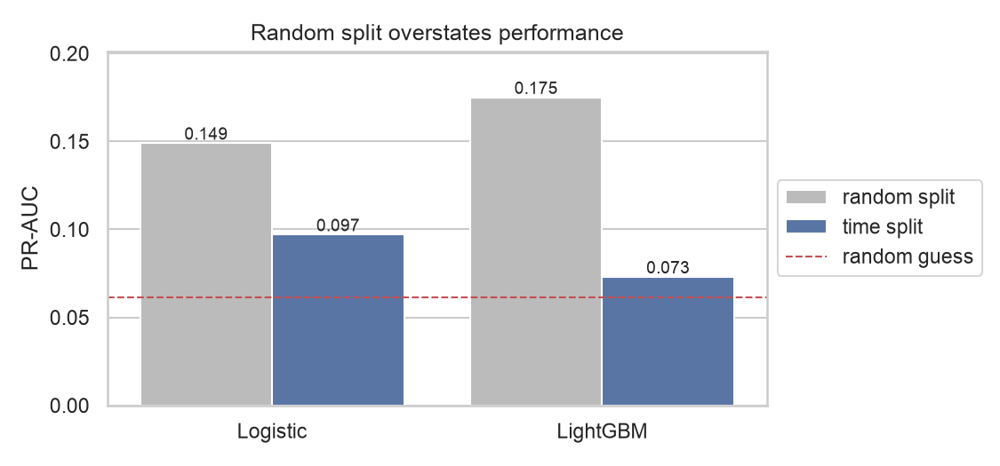

# SECOM: 공정 센서 기반 불량 예측

반도체 공정 센서 590개로 생산 단위의 Pass/Fail을 예측하고, 불량에 영향을 준 센서를 해석합니다.

## 실행 순서

```bash
# 저장소 루트에서 가상환경 활성화 후
cd secom
python scripts/download_data.py        # data/raw 다운로드 → data/processed/secom.parquet
python -m pytest -q                    # 전처리 누수 방지 테스트
jupyter notebook notebooks/
```

## 구조

```
secom/
├── scripts/download_data.py        # UCI에서 원본 다운로드 + 라벨/타임스탬프 병합
├── notebooks/
│   ├── 01_eda.ipynb                # 결측률, 상수 피처, 클래스 비율, 시간 drift
│   ├── 02_preprocessing.ipynb      # 시간순 분할, 전처리 Pipeline 결과 확인
│   └── 03_modeling.ipynb           # 로지스틱 회귀 vs LightGBM, 무작위 분할과 비교
├── src/
│   ├── data.py                     # 로드 + 시간순 train/test 분할
│   ├── preprocess.py               # 로지스틱용 / LightGBM용 Pipeline
│   └── models.py                   # 모델 정의, 시간순 교차검증으로 설정값 선택
├── tests/test_preprocess.py        # train에서만 학습하는지(누수 없음) 검증
├── data/                           # git 미포함 (스크립트로 재생성)
└── reports/                        # 그림, 모델 비교표, 선택된 설정값
```

## 전처리 설계

| | 로지스틱 회귀 | LightGBM |
|---|---|---|
| 고결측 센서 (train 결측 >50%) | 제거 | 제거 |
| 남은 결측 | train 중앙값 대체 | 그대로 둠 (모델이 직접 처리) |
| 상수 센서 | 제거 | 제거 |
| 센서 오류값 (예: 9998.9) | train 범위로 클리핑 | 그대로 둠 (트리는 순서만 사용) |
| 스케일 | 표준화 | 불필요 |
| 결측 지시자 | 옵션 (on/off 비교) | 옵션 |

시간순 분할: train 1175행 (07-19 ~ 09-29, 불량 80) / test 392행 (09-29 ~ 10-17, 불량 24) → 590개 중 444개 센서 사용.

## EDA 핵심 결과

| 발견 | 수치 | 결정 |
|---|---|---|
| 클래스 불균형 | fail 6.6% (104/1567) | PR-AUC·불량 재현율 주 지표, `class_weight` |
| 고결측 센서 | >50%: 28개, >80%: 8개 | train 기준 임계로 제거 + 중앙값 대체 |
| 결측-불량 연관 | 8개 센서 유의 (p<0.01), 단 시기와 교란 | 결측 지시자 on/off 실험 |
| 상수 센서 | 116개 | `VarianceThreshold` 제거 |
| 시간 drift | 월별 불량률 2.9%~22% | 시간순 train/test 분할 |
| 중복 센서 | 194개가 \|r\|>0.95 | 로지스틱: 표준화+L2 / SHAP: 상관 그룹 해석 |


## 모델 비교

설정값은 학습 데이터 안에서 시간순 교차검증(TimeSeriesSplit 4-fold, PR-AUC 기준)으로 골랐고, test는 마지막에 한 번만 평가했다.

| 모델 | CV PR-AUC | test PR-AUC | test ROC-AUC |
|---|---|---|---|
| 무작위 예측 | - | 0.061 | 0.5 |
| 로지스틱 회귀 (C=0.01, 결측 지시자 on) | 0.076 ± 0.036 | **0.097** | 0.669 |
| LightGBM (depth 2, colsample 0.1) | 0.174 ± 0.194 | 0.073 | 0.539 |

- 두 모델 모두 무작위보다 낫지만 격차는 작다. 센서 이름이 익명화되어 있고, 불량이 적고, 시기에 따라 공정이 바뀌는 데이터다.
- LightGBM은 CV 평균이 높았지만 fold별 편차가 커서(0.02~0.50) test에서 우위가 유지되지 않았다. 작은 데이터와 시기 변화에서는 단순한 모델이 더 안정적이었다.

### 무작위 분할은 성능을 부풀린다

| 모델 | 무작위 분할 (5회 평균) | 시간순 분할 |
|---|---|---|
| 로지스틱 회귀 | 0.149 | 0.097 |
| LightGBM | 0.175 | 0.073 |


