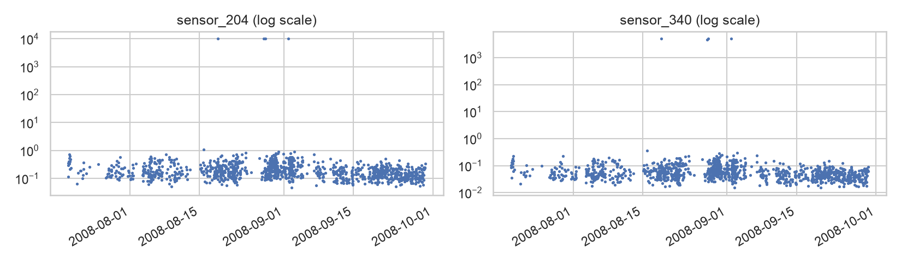
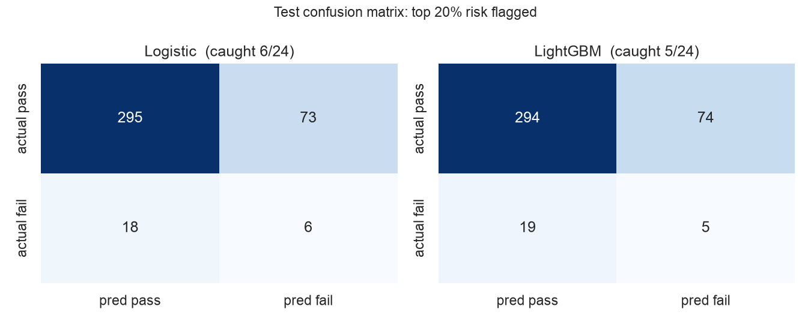

# SECOM: 공정 센서 기반 불량 예측

반도체 공정 센서 590개로 생산 단위의 Pass/Fail을 예측하고, 불량에 영향을 준 센서를 해석한다.

## 평가 원칙

1. 데이터를 가장 먼저 시간순으로 나눈다. 앞 75%(2008-07-19 ~ 09-29, 1175행)는 학습용, 뒤 25%(392행)는 평가용이다.
2. EDA, 전처리 기준, 모델 설정, 판정 기준은 모두 학습 데이터로만 정한다.
3. 모든 결정을 `PROTOCOL.md`에 적어 커밋한 뒤, `scripts/final_evaluation.py`로 평가 데이터를 한 번만 연다.
4. `src/data.py`의 `load_test()`는 잠금 문구가 있어야 열리고, 테스트가 최종 평가 스크립트 외의 호출을 막는다.

1차 작업(태그 `archive/v1`)에서는 탐색 중 평가 데이터 점수를 확인한 적이 있어 처음부터 다시 진행했다.

## 실행

```bash
# 저장소 루트에서 가상환경 활성화 후
cd secom
python scripts/download_data.py        # data/raw 다운로드 → data/processed/secom.parquet
python -m pytest -q
jupyter notebook notebooks/
```

## 구조

```
secom/
├── scripts/download_data.py   # UCI 원본 다운로드 + 라벨/시각 병합
├── PROTOCOL.md                # 평가 계획서 (평가 데이터를 열기 전에 커밋)
├── src/
│   ├── data.py                # 학습용 / 평가용(잠금) 불러오기
│   ├── preprocess.py          # 로지스틱용 / LightGBM용 전처리
│   ├── models.py              # 모델 정의, 시간순 교차검증 튜닝
│   └── evaluate.py            # 판정 규칙 결정, 지표, 신뢰구간
├── notebooks/
│   ├── 01_eda.ipynb           # 학습 데이터만으로 EDA
│   ├── 02_preprocessing.ipynb # 전처리 결과 확인
│   └── 03_modeling.ipynb      # 설정값 선택, 판정 방식 결정
├── scripts/final_evaluation.py # 평가 데이터를 여는 유일한 파일 (한 번 실행)
├── tests/                     # 평가 데이터 잠금, 전처리 누수 방지
├── data/                      # git 미포함 (스크립트로 재생성)
└── reports/figures/
```

## EDA 결과 (학습 데이터)

| 발견 | 수치 | 결정 |
|---|---|---|
| 불량이 드묾 | 80 / 1175 (6.8%) | PR-AUC, 불량 재현율. 정확도는 참고만 |
| 고결측 센서 | 50% 초과 24개 | 제거, 나머지 중앙값 대체(로지스틱) |
| 결측과 불량의 연관 | 8개 센서, 단 시기와 교란 | 결측 지시자 on/off는 교차검증으로 결정 |
| 상수 센서 | 122개 | 제거 |
| 시기 변화 | 월별 불량률 22% → 2.7% | 시간순 교차검증 |
| 센서 오류값 | 74개 센서 (예: 보통 0.17인데 9998) | 로지스틱: 0.5~99.5% 분위수로 자르기 |
| 중복 센서 | 191개가 \|r\|>0.95 | L2 규제, SHAP은 상관 그룹으로 해석 |




## 학습 데이터에서 내린 결정 (평가 전 고정)

`reports/best_params.json`

| 모델 | 설정 | CV PR-AUC (평균 ± 표준편차) | 판정 방식 |
|---|---|---|---|
| 로지스틱 회귀 | C=0.001, 결측 지시자 on | 0.095 ± 0.054 | 묶음 내 상위 20% |
| LightGBM | depth 2, colsample 0.1, 결측 지시자 off | 0.174 ± 0.194 | 묶음 내 상위 20% |

학습 불량 비율(무작위 기준선)은 0.068. 고정 기준값은 학습 기간 안에서도 다음 시기의 판정 비율이 6~24%로 흔들려, 계획서 규칙에 따라 두 모델 모두 묶음 내 할당량 방식을 쓴다.

## 최종 평가 (평가 데이터 1회)

`scripts/final_evaluation.py` 실행 결과 (코드 `83ed47b`). 전체 내용은 [reports/final/final_evaluation.md](reports/final/final_evaluation.md).

평가 데이터 392행, 불량 24개. 위험도 상위 20%를 불량으로 판정.

| 모델 | PR-AUC [95% 구간] | 불량 재현율 [95% 구간] | 정밀도 | 잡은 불량 |
|---|---|---|---|---|
| 무작위 | 0.061 | 0.20 | 0.061 | 기대값 4.8개 |
| 로지스틱 회귀 | 0.087 [0.055, 0.164] | 0.25 [0.09, 0.43] | 0.076 | 6/24 |
| LightGBM | 0.073 [0.044, 0.128] | 0.21 [0.07, 0.40] | 0.063 | 5/24 |




계획서 7절 규칙에 따른 해석
- 두 모델 모두 PR-AUC와 재현율 구간 하한이 무작위 기준선보다 높지 않다. **무작위보다 낫다고 단정할 수 없다.**
- 두 모델의 PR-AUC 차이 구간 [-0.023, +0.068]이 0을 포함한다. **우열을 단정할 수 없다.**
- 로지스틱 회귀는 검사 비율 20~50% 구간에서 무작위보다 위에 있지만, 불량 24개로는 우연과 구분되지 않는다.

사후 분석 (결정에 쓰지 않음): 같은 설정을 층화 무작위 분할로 평가하면 PR-AUC가 로지스틱 0.170, LightGBM 0.175로 시간순 분할의 약 2~2.4배다. 같은 시기 제품이 학습과 평가에 섞이면 성능이 부풀려진다.
