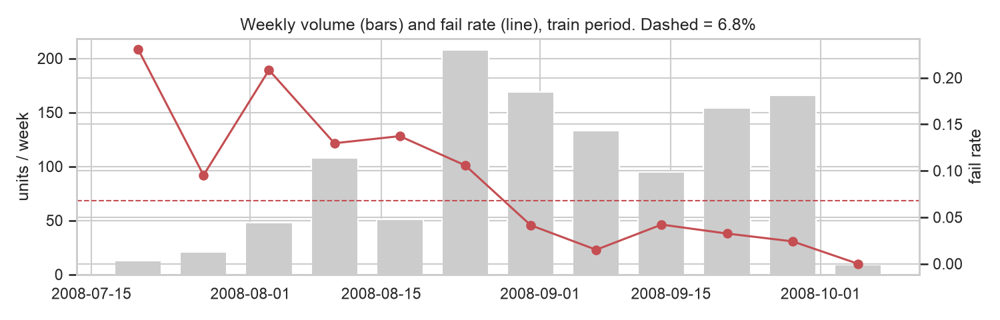
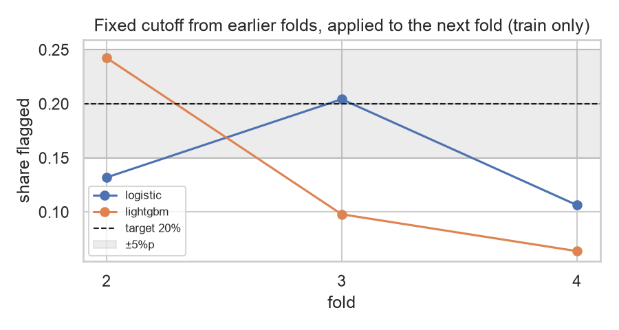
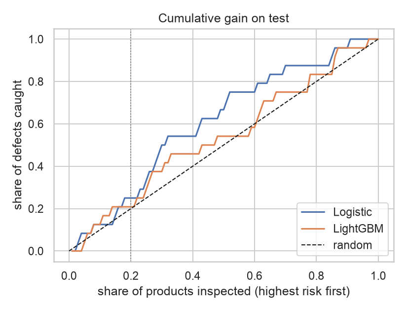
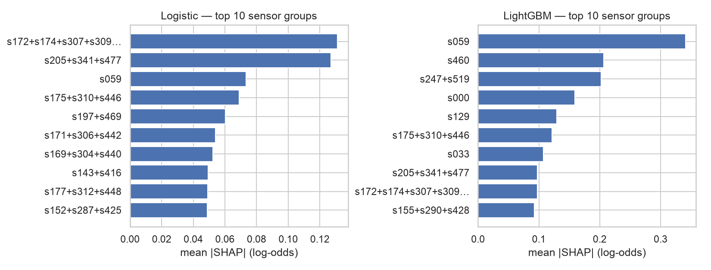

# SECOM: 공정 센서 기반 불량 예측

반도체 공정 센서 590개로 생산 단위의 불량 여부를 예측하고, 엔지니어가 먼저 점검할 센서를 찾는다.

## 요약

- **평가를 먼저 설계했다.** 데이터를 시간순으로 나눠 평가 데이터를 잠그고, 모든 결정을 [평가 계획서](PROTOCOL.md)로 커밋한 뒤 평가 데이터를 한 번만 열었다.
- **결과는 정직하게 보고했다.** 위험도 상위 20%를 검사하면 로지스틱 회귀가 불량 24개 중 6개를 잡았지만(무작위 기대값 4.8개), 신뢰구간으로는 무작위와 구분되지 않는다.
- **무작위 분할은 성능을 2배 이상 부풀린다.** 같은 모델이 무작위 분할에서는 PR-AUC 0.17, 시간순 분할에서는 0.07~0.09였다.
- **점검 후보는 세 가지 기준으로 걸렀다.** 두 모델의 일치, 학습 기간을 바꿔도 유지되는지, 같은 달 안에서도 관계가 남는지.

## 1. 문제와 데이터

| 항목 | 내용 |
|---|---|
| 데이터 | [UCI SECOM](https://archive.ics.uci.edu/dataset/179/secom). 1567개 생산 단위, 센서 590개 (이름 익명), 2008-07 ~ 10 |
| 라벨 | 공정 내 테스트 Pass / Fail. 불량 104개 (6.6%) |
| 목표 | 센서 값으로 불량을 미리 골라내 추가 검사 대상을 정하고, 불량과 관련된 센서를 찾는다 |

## 2. 데이터에서 발견한 것 (학습 데이터만)

| 발견 | 수치 | 결정 |
|---|---|---|
| 불량이 드묾 | 80 / 1175 (6.8%) | 정확도 대신 PR-AUC와 불량 재현율, `class_weight` |
| 시기에 따라 불량률이 변함 | 월별 22% → 9% → 2.7% | 시간순 분할과 시간순 교차검증 |
| 센서 오류값 | 74개 센서. 예: 보통 0.17인데 9998 | 로지스틱 회귀용은 0.5~99.5% 분위수로 자르기 |
| 고결측, 상수 센서 | 결측 50% 초과 24개, 상수 122개 | 제거 → 444개 사용 |
| 결측이 시기와 얽힘 | 결측 여부가 불량과 연관된 센서 8개, 단 시기와 겹침 | 결측 지시자는 교차검증으로 사용 여부 결정 |
| 중복 센서 | 191개가 다른 센서와 \|r\| > 0.95 | L2 규제, 해석 시 그룹으로 묶음 |



## 3. 평가 설계

평가 데이터 정보가 결정에 섞이지 않도록 순서를 고정했다. 각 단계는 별도 커밋으로 남아 있다.

| 순서 | 내용 | 커밋 |
|---|---|---|
| 1 | 시간순 분할(앞 75% 학습 / 뒤 25% 평가), 평가 데이터 잠금, 학습 데이터 EDA | [`958d916`](https://github.com/heerohyoon/manufacturing-ai-portfolio/commit/958d916) |
| 2 | 평가 계획서 커밋: 전처리, 후보 설정, 판정 규칙, 보고 지표, 해석 규칙 | [`cf4ab47`](https://github.com/heerohyoon/manufacturing-ai-portfolio/commit/cf4ab47) |
| 3 | 학습 데이터로 설정값과 판정 방식 결정, 고정 | [`915c0bc`](https://github.com/heerohyoon/manufacturing-ai-portfolio/commit/915c0bc) |
| 4 | 평가 스크립트 커밋 (학습 데이터로 리허설 후) | [`8a9668a`](https://github.com/heerohyoon/manufacturing-ai-portfolio/commit/8a9668a) |
| 5 | 평가 데이터 1회 평가 | [`d75204f`](https://github.com/heerohyoon/manufacturing-ai-portfolio/commit/d75204f) |

- 평가 데이터는 `src/data.py`의 잠금 함수로만 열리고, 테스트가 최종 평가 스크립트 외의 호출을 막는다.
- 결측 대체값, 분위수, 표준화 값은 모두 sklearn Pipeline 안에서 학습 데이터로만 계산한다.
- 첫 작업(태그 [`archive/v1`](https://github.com/heerohyoon/manufacturing-ai-portfolio/tree/archive/v1))에서 탐색 중 평가 데이터 점수를 확인한 적이 있어 처음부터 다시 진행했다. 그때 알게 된 내용은 계획서 9절에 공개했다.

### 판정 방식: 고정 기준값 대신 묶음 내 할당량

운영 가정은 "제품의 20%까지 추가 검사할 수 있다"이다. 학습 기간 안에서 이전 시기로 정한 확률 기준값을 다음 시기에 적용하면 판정 비율이 6~24%로 흔들렸다. 시기가 바뀌면 모델 확률이 전체적으로 이동하기 때문이다. 그래서 계획서 규칙에 따라 묶음 안에서 위험도 상위 20%를 판정하는 방식을 쓴다.



## 4. 결과

평가 데이터 392개, 불량 24개. 위험도 상위 20%를 불량으로 판정.

| 모델 | PR-AUC [95% 구간] | 불량 재현율 [95% 구간] | 정밀도 | 잡은 불량 |
|---|---|---|---|---|
| 무작위 | 0.061 | 0.20 | 0.061 | 기대값 4.8개 |
| 로지스틱 회귀 | 0.087 [0.055, 0.164] | 0.25 [0.09, 0.43] | 0.076 | 6 / 24 |
| LightGBM | 0.073 [0.044, 0.128] | 0.21 [0.07, 0.40] | 0.063 | 5 / 24 |



계획서에 미리 정한 해석 규칙(구간 하한이 기준선보다 높을 때만 "낫다")에 따르면
- 두 모델 모두 **무작위보다 낫다고 단정할 수 없다.**
- 두 모델 차이 구간 [-0.023, +0.068]이 0을 포함하므로 **우열을 단정할 수 없다.**

**무작위 분할과 비교** (평가 이후 분석, 결정에 쓰지 않음)

| 모델 | 무작위 분할 (5회 평균) | 시간순 분할 |
|---|---|---|
| 로지스틱 회귀 | 0.170 | 0.087 |
| LightGBM | 0.175 | 0.073 |

전체 결과: [reports/final/final_evaluation.md](reports/final/final_evaluation.md)

결과 파일에 적힌 코드 버전 `83ed47b`는 커밋 기록을 정리하면서 해시가 바뀐 것으로, 현재 `8a9668a`와 같은 코드다.

## 5. 점검 후보 센서 (SHAP)

모델 성능이 무작위와 구분되지 않으므로, SHAP 결과는 불량 원인이 아니라 먼저 확인해 볼 후보로 다룬다. 학습 데이터만 사용했다.



| 후보 | 근거 | 신뢰도 |
|---|---|---|
| **s059** | 두 모델 공통 상위. 같은 달 안에서도 값이 높을수록 불량률 상승 (8월 3.2% → 14.7%) | 상대적으로 높음 |
| **s175+s310+s446** | 두 모델 공통 상위, 학습 기간을 바꿔도 꾸준함, 같은 달 안에서도 같은 방향 | 상대적으로 높음 |
| s205+s341+s477 | 두 모델 공통 상위, 같은 달 안에서도 같은 방향, 기간에 따라 순위가 흔들림 | 중간 |
| s247+s519 | LightGBM 상위권이지만 결측 여부가 시기를 대신하는 것으로 보임 | 낮음 |

- 중복 센서는 순위 상관(스피어만)으로 묶었다. 일반 상관(피어슨)으로는 오류값 4개 행 때문에 무관한 센서가 상관 0.97로 묶였다.
- 같은 달 안에서 비교한 이유: 불량률이 시기에 따라 크게 변해서, 시간에 따라 값이 변하는 센서는 실제 관계가 없어도 중요해 보일 수 있다.

## 6. 한계와 다음 단계

- 평가 데이터의 불량이 24개뿐이라 신뢰구간이 넓다. 더 긴 기간의 데이터가 필요하다.
- 센서 이름이 익명이라 도메인 지식으로 특징을 만들 수 없다. 실제 현장이라면 s059가 어느 장비·공정 단계의 무슨 값인지 확인하는 것이 다음 단계다.
- 시기 변화가 크므로 운영 시 주기적 재학습과 판정 비율 모니터링이 필요하다.

## 실행

```bash
# 저장소 루트에서 가상환경 활성화 후
cd secom
python scripts/download_data.py   # UCI에서 내려받아 data/processed/secom.parquet 생성
python -m pytest -q               # 평가 데이터 잠금, 전처리 누수 방지 테스트
jupyter notebook notebooks/
```

`scripts/final_evaluation.py`는 이미 실행했으므로 다시 실행하면 멈춘다(`--force`로 재현 가능).

## 구조

```
secom/
├── PROTOCOL.md                  # 평가 계획서 (평가 데이터를 열기 전에 커밋)
├── scripts/
│   ├── download_data.py         # UCI 원본 다운로드, 라벨과 시각 병합
│   └── final_evaluation.py      # 평가 데이터를 여는 유일한 파일
├── src/
│   ├── data.py                  # 학습용 / 평가용(잠금) 불러오기
│   ├── preprocess.py            # 로지스틱용 / LightGBM용 전처리
│   ├── models.py                # 모델 정의, 시간순 교차검증 튜닝
│   ├── evaluate.py              # 판정 방식 결정, 지표, 신뢰구간
│   └── interpret.py             # SHAP, 순위 상관 기반 센서 그룹
├── notebooks/
│   ├── 01_eda.ipynb             # 학습 데이터 EDA
│   ├── 02_preprocessing.ipynb   # 전처리 결과 확인
│   ├── 03_modeling.ipynb        # 설정값 선택, 판정 방식 결정
│   └── 04_shap.ipynb            # 점검 후보 센서
├── tests/                       # 평가 데이터 잠금, 전처리 테스트
├── reports/                     # 고정된 설정, 최종 결과, 그림
└── data/                        # git 미포함 (스크립트로 재생성)
```
