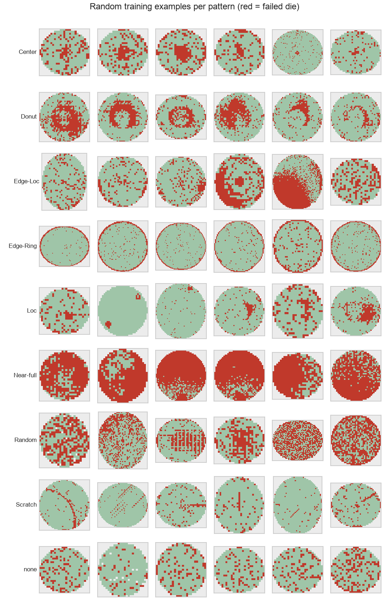
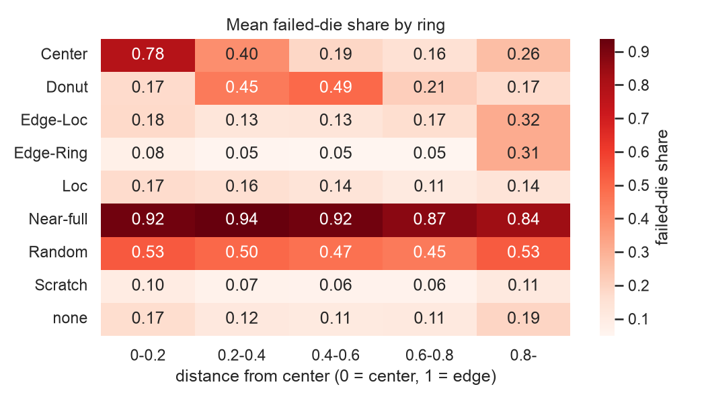
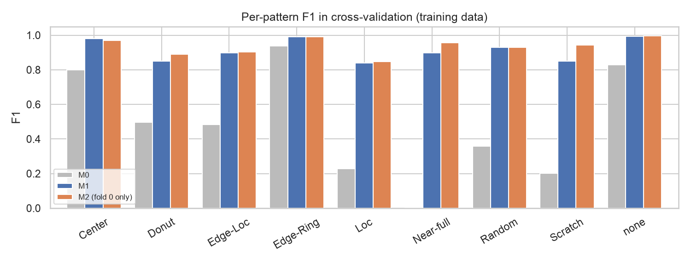
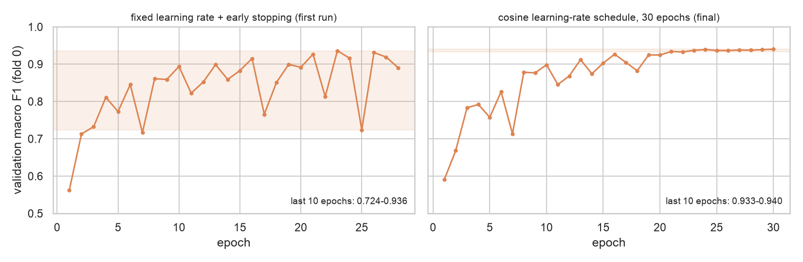
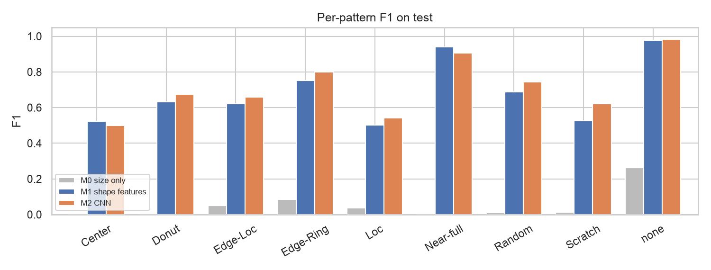
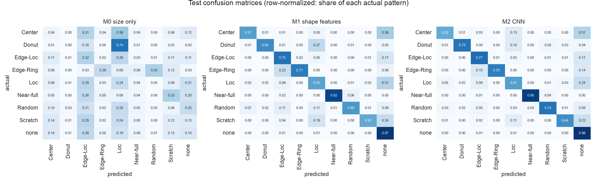

# Wafer Map: 불량 패턴 분류

WM-811K 웨이퍼 맵으로 Center, Edge-Ring, Scratch 등 9가지 불량 패턴을 분류한다.

> [!NOTE]
> **웨이퍼 맵**은 완성된 웨이퍼의 칩을 하나하나 전기 검사한 결과를 칩 위치대로 그린 지도다. 각 칸은 0(칩 없음), 1(정상), 2(불량)다.
> 불량 칩이 어디에 몰렸는지(가운데, 가장자리 고리, 선 모양 등)를 보면 어느 공정에 문제가 있었는지 짐작할 수 있다.
> 공장에서 나오는 맵을 사람이 전부 볼 수 없어서, 패턴을 자동으로 분류하는 것이 이 프로젝트의 목표다.

## 데이터

| 항목 | 내용 |
|---|---|
| 출처 | [WM-811K (Kaggle)](https://www.kaggle.com/datasets/qingyi/wm811k-wafer-map), Wu et al. (2015) |
| 전체 | 웨이퍼 맵 811,457개, 그중 라벨 있는 것 172,950개 |
| 클래스 | Center, Donut, Edge-Loc, Edge-Ring, Loc, Near-full, Random, Scratch, none |
| 분할 | 원본 분할 그대로. 학습 54,355개(5,809 로트) / 평가 118,595개(4,953 로트), 겹치는 로트 없음 |

> [!NOTE]
> **라벨은 데이터셋에 원래 들어 있던 것이다.** 현장 전문가가 붙인 것으로 알려져 있고, 81만 개 중 약 17만 개에만 있다.
> 8개는 불량 패턴이고 `none`은 "특별한 패턴 없음"이다. 사람이 붙인 라벨이라 일부 오류나 애매한 경우가 섞여 있을 수 있다.

> [!NOTE]
> **로트(lot)** 는 공장에서 함께 묶여 같은 장비, 같은 시간, 같은 조건으로 공정을 거치는 웨이퍼 묶음(최대 25장)이다.
> 같은 로트의 웨이퍼는 같은 문제를 함께 겪어 불량 패턴도 비슷하다(Edge-Ring이 나온 로트의 92%가 Edge-Ring).
> 판별 단위는 웨이퍼 한 장이고, 로트는 데이터를 나눌 때만 쓴다. 같은 로트가 학습과 평가에 섞이면 형제 웨이퍼를 보고 답을 맞히게 되어 점수가 부풀려지기 때문이다.

원본 분할을 쓴 이유
- 이미 로트 단위로 나뉘어 있어 같은 로트가 학습과 평가에 섞이지 않는다.
- 평가 데이터 라벨을 보지 않고 바로 잠글 수 있다. 새로 나누려면 층화를 위해 전체 라벨을 먼저 봐야 한다.
- 같은 분할을 쓰는 기존 연구와 비교할 수 있다.
- 대신 학습 데이터가 라벨 있는 데이터의 31%뿐이라, 드문 패턴(Near-full 54개)이 적다.

## 평가 지표

주 지표는 **매크로 F1**이다.

> [!NOTE]
> 한 패턴의 **재현율**은 "그 패턴인 웨이퍼 중 몇 개를 찾았나", **정밀도**는 "그 패턴이라고 한 것 중 진짜는 몇 개인가"다.
> **F1**은 둘을 하나로 합친 점수로, 둘 중 하나만 높아서는 높게 나오지 않는다.
> **매크로 F1**은 9개 패턴의 F1을 같은 비중으로 평균한 것이다. `none`이 36,730개, `Near-full`이 54개여도 둘 다 1/9씩 반영된다.
>
> 정확도를 쓰지 않는 이유: 학습 데이터의 68%가 `none`이라, 전부 `none`이라고 해도 정확도 68%가 나온다.
> 현장에서는 오히려 드문 패턴(장비 긁힘을 뜻할 수 있는 Scratch, 웨이퍼 전체가 망가진 Near-full)을 놓치는 것이 비싸다.
> 다만 드문 패턴 몇 개가 점수를 크게 흔들 수 있어서 패턴별 점수와 신뢰구간을 함께 본다.

## EDA 결과 (학습 데이터)



| 발견 | 수치 | 결정 |
|---|---|---|
| 심한 불균형 | none 67.6%, Near-full 54개 | 매크로 F1, 패턴별 재현율, 클래스 가중치 |
| 패턴마다 위치가 다름 | 고리별 불량 밀도가 패턴마다 다름. Edge-Loc과 Edge-Ring은 방향 정보가 필요 | 기준 모델: 고리별·방향별 밀도 등 직접 만든 특징 + LightGBM |
| 크기가 제각각 | 94%가 64칸 이하. 큰 맵을 단순히 줄이면 가는 선이 사라짐 | 64×64, 줄일 때 불량 칩 보존 |
| **맵 크기가 답을 알려줌** | 맵 크기만으로 매크로 F1 0.48 (Edge-Ring 0.94) | 크기만 쓴 모델을 기준선으로, 학습에 없던 크기의 웨이퍼 성능 따로 보고 |
| 로트 안 패턴 반복 | Edge-Ring이 나온 로트의 92%가 Edge-Ring | 교차검증도 로트 단위 |
| 똑같은 맵 | 평가 데이터에 학습 데이터와 똑같은 맵 3,158개 | 똑같은 맵을 뺀 점수도 보고 |
| 라벨 오류 가능성 | 눈으로 봐도 다른 패턴 같은 예가 있음 | 결과 해석 시 한계로 언급 |

> [!NOTE]
> **맵 크기가 답을 알려준다는 것**: 맵 크기는 사실상 제품 종류다. 특정 제품에서 특정 불량이 반복되어,
> 예를 들어 `38x36` 크기는 전부 Edge-Ring이다. 모델이 모양 대신 "어떤 제품인가"를 외울 수 있어서,
> 크기만 쓰는 모델(M0)을 기준선으로 두고 학습에 없던 크기(새 제품)에서의 성능을 따로 본다.



## 모델

| 이름 | 입력 | 모델 | 목적 |
|---|---|---|---|
| M0 크기 기준선 | 원래 맵의 세로, 가로, 칩 개수 | LightGBM | 맵 내용(불량 위치)을 보지 않고 제품 정보만으로 얼마나 맞히나 |
| M1 특징 모델 | 사람이 설계한 모양 특징 20개 | LightGBM | 사람의 아이디어로 만든 특징으로 얼마나 맞히나 |
| M2 CNN | 64×64 맵 그림 (칩 위치, 불량 위치 두 장) | CNN | 그림에서 직접 배우면 얼마나 더 맞히나 |

> [!NOTE]
> 세 모델 모두 같은 전문가 라벨로 배운다(지도 학습). 차이는 **무엇을 보고 배우느냐**다.
> M0와 M1은 모델(LightGBM)을 같게 두고 입력만 바꿨다. 그래야 점수 차이를 "모양 정보를 넣은 효과"로 읽을 수 있다.
> M1은 사람이 "고리별, 방향별 불량 밀도와 덩어리의 길쭉함을 봐라"고 정해 준 것이고,
> M2는 어디를 봐야 하는지를 스스로 찾는다. 패턴 이름과 정답은 둘 다 사람이 준다.

> [!NOTE]
> **CNN이 그림을 보는 방법**
> 1. **필터로 훑기**: 3×3 같은 작은 창을 맵 전체에 한 칸씩 옮기며, 겹치는 칸끼리 곱해 더한다. 특정 모양(예: 가로 선)이 있는 곳에서만 큰 값이 나오는 새 지도가 생긴다. 같은 필터를 모든 위치에 쓰므로 패턴이 어디에 있든 찾는다.
> 2. **줄이기(풀링)**: 지도를 2×2씩 묶어 가장 큰 값만 남긴다. 위치가 조금 달라도 같은 결과가 나오고 계산이 줄어든다.
> 3. **층 쌓기**: 아래층은 점과 짧은 선, 위층은 그 조각을 조합한 고리나 긴 선을 찾는다.
>
> 필터 안의 숫자는 사람이 정하지 않고 학습으로 정해진다.
> 층이 깊어질수록 지도 크기는 64→32→16→8로 줄고 필터(=지도 장수)는 32→64→128로 늘린다.
> 위층의 한 칸은 웨이퍼의 넓은 영역(약 36×36칸)을 보므로 정확한 위치는 덜 중요해지고, 대신 조각을 조합한 모양의 종류가 많아지기 때문이다.
> 크기를 절반으로 줄일 때 필터를 두 배로 늘리면 층마다 계산량도 비슷하게 유지된다.

## 학습과 검증

1. **교차검증(모의고사)**: 학습 데이터를 로트 단위로 5조각으로 나눠, 4조각으로 학습하고 1조각으로 점수를 잰다.
2. **설정 선택**: M1은 설정 4가지를 5-fold 평균으로 비교해 골랐다. M2는 학습 시간 때문에 fold 0 하나로만 검증했다.
3. **최종 학습**: 고른 설정으로 학습 데이터 전체(100%)를 처음부터 다시 학습한다.
4. **최종 평가**: 잠가 둔 평가 데이터로 한 번만 채점한다.

> [!NOTE]
> **에폭**은 학습 데이터 전체를 한 바퀴 보는 것이다. 30에폭이면 같은 데이터를 30바퀴 본다.
> 모의고사 학습에서는 매 에폭마다 같은 80%로 한 바퀴 학습하고, 공부에 쓰지 않은 같은 20%로 점수를 쟀다.
> 에폭마다 "그때까지의 실력"을 기록한 것이지, 에폭 하나하나가 다른 방법이거나 시험인 것은 아니다.

> [!NOTE]
> **모의고사 학습과 최종 학습을 나눈 이유**
> - 모의고사 학습은 학습 방법(레시피)이 제대로 작동하는지, 몇 에폭이면 되는지, 대략 몇 점인지를 확인하는 단계다. 점수를 재려면 모델이 보지 않은 데이터가 있어야 해서 20%를 빼놓는다.
> - 실제로 이 단계에서 점수가 크게 출렁이는 문제를 발견해 레시피를 고쳤다. 최종 학습에는 모의고사가 없어 학습 손실만 보이는데, 손실은 꾸준히 내려가서 이 문제가 보이지 않는다.
> - 최종 학습은 확인한 레시피로 빼놓았던 20%까지 전부 써서 다시 학습한다. 모의고사 때 학습된 가중치를 이어 쓰지 않고, 처음부터 다시 학습한다. Near-full처럼 드문 패턴은 한 장이라도 더 보는 게 중요하기 때문이다.
> - 대신 최종 모델 자체의 검증 점수는 없다. 같은 레시피라 비슷하게 학습됐을 것이라고 보고, 실제 성능은 평가 데이터로 확인한다.

> [!NOTE]
> **CNN은 튜닝하지 않았다.** M2는 사실상 한 가지 레시피만 썼고(첫 레시피의 불안정을 고친 것 하나), 학습률이나 모델 크기를 여러 개 비교하지 않았다.
> 한 번 학습에 약 40분이 걸리고, 검증 fold가 하나뿐이라 많이 시험할수록 그 fold에 우연히 맞는 설정을 고를 위험이 커서다.
> 시간이 충분하다면 여러 fold로 검증하면서 학습률과 모델 크기를 탐색하고, 비교 대상(M1)도 같은 정도로 튜닝하는 것이 맞다.
> 그래서 이 결과는 "CNN의 최고 성능"이 아니라 "미리 정한 작은 CNN의 성능"이다.

## 교차검증 결과 (학습 데이터, 로트 단위 5-fold)

| 모델 | 매크로 F1 | 비고 |
|---|---|---|
| M0 크기 기준선 | 0.484 | 맵 내용을 보지 않음 |
| M1 특징 모델 | 0.914 | `num_leaves=31`, `min_child_samples=20` |
| M2 CNN | 0.940 (fold 0만) | 코사인 학습률 스케줄, 30에폭을 마친 모델 |



- 모양 특징을 넣으면 크기만 볼 때보다 크게 오른다(0.48 → 0.91).
- M1 대비 M2의 차이는 Scratch(0.85 → 0.94)와 Near-full(0.90 → 0.96)에서 가장 크다. Scratch는 휘거나 끊긴 선이라 사람이 만든 "길쭉함" 특징만으로는 다 잡히지 않는다.

### CNN 학습 방식 변경

첫 학습(학습률 고정 + 조기 종료)에서 검증 점수가 에폭마다 0.72~0.94로 흔들렸다. 추세는 오르는 중이라 과적합보다는 학습률이 끝까지 커서 생긴 불안정으로 보고,
학습률을 코사인 곡선으로 줄이며 30에폭을 다 채우도록 바꿨다. 마지막 10에폭이 0.933~0.940에 모였다. 평가 데이터를 열기 전 학습 데이터에서 발견한 문제이며, PROTOCOL.md 변경 기록에 남겼다.



> [!NOTE]
> **에폭을 많이 하면 무조건 좋은가?** 아니다. 같은 데이터를 너무 많이 보면 이해 대신 답을 외우는 과적합이 생겨 새 데이터 점수가 떨어진다. 그래서 보통 검증 점수가 더 오르지 않으면 멈춘다(조기 종료).
> 하지만 첫 학습의 출렁임은 과적합이 아니었다. 과적합이면 검증 점수가 오르다가 꾸준히 내려가야 하는데, 이번에는 추세가 오르면서 위아래로 흔들렸다.
> 그 상태에서 가장 높았던 에폭(23)을 고르면 우연히 높게 나온 지점을 고르게 되고, 최종 학습의 23에폭이 좋은 지점이라는 보장도 없다.

> [!NOTE]
> **학습률을 줄이면 왜 안정되는가?** 학습은 틀린 정도(손실)가 가장 낮은 골짜기 바닥을 찾아 내려가는 것이고, 학습률은 한 번에 움직이는 보폭이다.
> 보폭이 끝까지 크면 바닥 근처에서 바닥을 지나쳐 왔다 갔다 한다. 게다가 모델은 매번 256장만 보고 방향을 정해서 방향이 조금씩 틀리는데, 보폭이 크면 그 오차가 크게 반영된다.
> 흔한 패턴은 어느 위치에서든 비슷하게 맞히지만 드문 패턴은 들쭉날쭉해지고, 매크로 F1은 드문 패턴도 1/9씩 반영하므로 점수가 크게 흔들린다.
> 코사인 스케줄은 처음에는 큰 보폭으로 빨리 내려가고, 끝으로 갈수록 보폭을 줄여 바닥에 자리 잡게 한다.
> 실제로 학습률이 줄어드는 구간에서 출렁임 폭이 약 0.19 → 0.07 → 0.05 → 0.007로 같이 줄었다.

## 최종 평가 (평가 데이터 1회)

`scripts/final_evaluation.py` 실행 결과 (코드 `c5d1dd9`). 전체 내용은 [reports/final/final_evaluation.md](reports/final/final_evaluation.md).
평가 데이터 118,595개 웨이퍼(4,953 로트). 구간은 로트 단위 부트스트랩 95%.

| 모델 | 매크로 F1 [95% 구간] | 새 크기(8,263개) | 중복 제외 | 교차검증 |
|---|---|---|---|---|
| M0 크기 기준선 | 0.051 [0.047, 0.057] | 0.010 | 0.047 | 0.484 |
| M1 특징 모델 | 0.685 [0.670, 0.699] | 0.721 | 0.680 | 0.914 |
| M2 CNN | **0.714** [0.698, 0.727] | **0.734** | 0.710 | 0.940 (fold 0) |

| 비교 | 차이 [95% 구간] | 계획서 규칙에 따른 해석 |
|---|---|---|
| M2 − M1 | +0.029 [+0.015, +0.042] | CNN이 낫다 |
| M1 − M0 | +0.634 [+0.618, +0.646] | 특징 모델이 낫다 |




**결과 해석**
- **CNN이 특징 모델보다 낫다.** 차이는 작지만(+0.029) 구간이 0보다 위다. 차이가 큰 패턴은 Scratch(0.53 → 0.62), Random(0.69 → 0.74), Edge-Ring(0.75 → 0.80)이다.
- **두 모델 모두 크기 지름길에 기대지 않는다.** 학습에 없던 크기(새 제품)에서도 점수가 전체와 비슷하거나 조금 높다.
- **크기 지름길은 평가 데이터에서 통하지 않았다.** M0가 교차검증 0.48에서 0.05로 무너졌다. 학습 로트에서 보인 "이 크기면 이 패턴" 관계가 평가 로트에서는 성립하지 않는다.
- **교차검증보다 평가 점수가 크게 낮다(0.91~0.94 → 0.69~0.71).** 아래 사후 분석 참고.

### 교차검증과 평가 점수의 차이 (사후 분석, 결정에 쓰지 않음)

| 패턴 | 학습 데이터 비율 | 평가 데이터 비율 |
|---|---|---|
| none | 67.6% | **93.3%** |
| Edge-Ring | 15.7% | 0.9% |
| Center | 6.4% | 0.7% |

- 원본 분할은 학습과 평가의 패턴 비율이 매우 다르다. 평가 데이터는 93%가 `none`이라, `none` 웨이퍼 중 아주 일부만 패턴으로 잘못 판정해도 드문 패턴의 정밀도가 크게 떨어진다.
- 그런데 재현율도 떨어졌다(예: Center 교차검증 약 0.97 → 평가 0.52~0.57). 비율 차이만으로는 설명되지 않고, 학습 로트와 평가 로트 사이에 제품 구성이나 패턴 모양, 라벨을 붙인 기준이 다를 가능성이 있다. M0의 붕괴도 같은 방향을 가리킨다.
- 즉 **같은 공장 데이터라도 로트 묶음이 바뀌면 성능이 크게 달라질 수 있다.** 학습 데이터 안의 교차검증 점수만 믿으면 실제 성능을 과대평가하게 된다.
- 원인을 좁히려면 틀린 사례를 직접 보는 분석이 필요하다(PROTOCOL.md 8절).

## 실행

```bash
# 저장소 루트에서 가상환경 활성화 후
cd wafer-map
# Kaggle에서 LSWMD.pkl을 내려받아 data/raw/에 둔다
python scripts/prepare_data.py   # 학습용 / 평가용(잠금) 파일 생성
python -m pytest -q
python scripts/train.py          # M0, M1 교차검증 → CNN 학습(별도 프로세스)
```

## 구조

```
wafer-map/
├── PROTOCOL.md               # 평가 계획서 (평가 데이터를 열기 전에 커밋)
├── scripts/
│   ├── prepare_data.py       # 원본 읽기(구버전 pickle 호환), 라벨 있는 웨이퍼만, 원본 분할로 저장
│   ├── make_viewer.py        # 학습 데이터를 패턴별로 넘겨보는 HTML 뷰어
│   ├── train.py              # M0, M1 교차검증과 설정 선택 → train_cnn.py를 별도 프로세스로 실행
│   ├── train_cnn.py          # M2 CNN: fold 0 검증, 전체 데이터로 최종 학습
│   ├── final_evaluation.py   # 평가 데이터를 여는 유일한 파일 (한 번 실행)
│   └── predict_cnn.py        # CNN 예측을 별도 프로세스로
├── notebooks/
│   ├── 01_eda.ipynb          # 학습 데이터만으로 EDA
│   └── 02_models.ipynb       # 교차검증 결과 정리
├── src/
│   ├── data.py               # 학습용 / 평가용(잠금) 불러오기
│   ├── preprocess.py         # 64x64 변환 (불량 보존)
│   ├── features.py           # M0 크기 특징, M1 모양 특징
│   ├── evaluation.py         # 로트 단위 교차검증, 매크로 F1
│   ├── models.py             # M0, M1 (LightGBM)
│   └── cnn.py                # M2 (PyTorch)
├── models/cnn_final.pt       # 평가 전에 고정한 최종 CNN 가중치
├── tests/                    # 평가 데이터 잠금, 전처리·특징, 모듈 분리 확인
└── data/                     # git 미포함
```

> [!NOTE]
> `models.py`(LightGBM)와 `cnn.py`(PyTorch)는 한 프로그램에서 함께 쓰지 않는다. macOS에서 둘이 서로 다른 OpenMP 라이브러리를 쓰는데,
> 같은 프로세스에서 PyTorch가 CPU 연산을 한 뒤 LightGBM을 학습하면 멈추거나 죽는 것을 재현 실험으로 확인했다.
> 그래서 CNN은 별도 스크립트로 돌리고, `tests/test_structure.py`가 한 파일에서 둘을 같이 불러오지 못하게 막는다.
